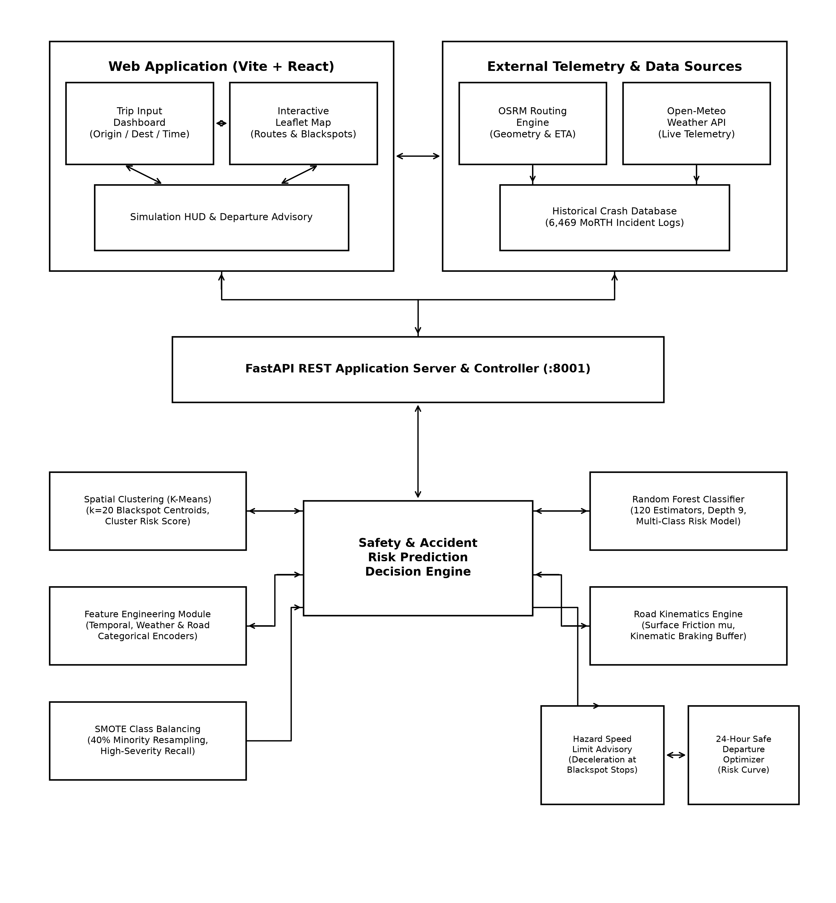

# Route - Wise AI: Route-Wise Traffic Accident Risk Prediction and Proactive Safety Mitigation System Using Geospatial Data and Multi-Factor Machine Learning

&nbsp;

&nbsp;

&nbsp;&nbsp;&nbsp;&nbsp;&nbsp;&nbsp;&nbsp;&nbsp;&nbsp;&nbsp;&nbsp;&nbsp;&nbsp;&nbsp;Dr. N. Subbulakshmi

*Department of Computer Science and Engineering*

*Kalasalingam Academy of Research and Education*

Krishnankoil, Tamil Nadu, India.

[\<subbulakshmi@kalasalingam.ac.in\>](mailto:subbulakshmi@kalasalingam.ac.in)

&nbsp;

&nbsp;

Duttaluri Karimulla

*Department of Computer Science and Engineering*

*Kalasalingam Academy of Research and Education*

Krishnankoil, Tamil Nadu, India.

[\<k9000sep@gmail.com\>](mailto:k9000sep@gmail.com)

&nbsp;

Esambadi Goutham Reddy

*Department of ComputerScience and                  Engineering*

*Kalasalingam Academy of Research and Education*

Krishnankoil, Tamil Nadu, India.

\<esambadigouthamreddy@gmail.com\>

&nbsp;

&nbsp;

Gaduputi Ramya Sree

*Department of Computer Science and Engineering*

*Kalasalingam Academy of Research and Education*

Krishnankoil, Tamil Nadu, India.

[99240040038@klu.ac.in](mailto:99240040038@klu.ac.in)

Gadde Sai Naga Abhiram

*Department of Computer Science and Engineering*

*Kalasalingam Academy of Research and Education*

Krishnankoil, Tamil Nadu, India.

[\<abhiramgadde2007@gmail.com\>](mailto:abhiramgadde2007@gmail.com)

&nbsp;

&nbsp;

J Gayathri

*Department of Bio Technology Kalasalingam Academy of Research and*

*Education*

Krishnankoil, Tamil Nadu, India.

[9924001029@klu.ac.in](mailto:9924001029@klu.ac.in)

&nbsp;

&nbsp;

**Abstract— Road traffic collisions represent a critical global public health crisis and a leading cause of preventable trauma. Conventional Global Positioning System (GPS) navigation platforms optimize routes exclusively for travel duration or congestion bypass, remaining fundamentally oblivious to underlying road hazard topology, historical accident density, and non-stationary environmental risks. This research introduces a comprehensive, end-to-end Intelligent Transportation and Predictive Analytics Framework that computes route-wise accident risk, classifies crash severity, models road surface kinematics, and generates proactive departure time recommendations. The system ingests and preprocesses 24,000+ raw crash records across national highway logs and municipal incident registries, filtering GPS coordinate anomalies into a verified benchmark dataset of 6,469 observations across four operational time buckets (Morning: 1,910; Afternoon: 2,230; Evening: 1,090; Night: 1,239). A spatial K-Means clustering algorithm ($k=20$) computes dynamic cluster risk density scores ($\text{Cluster\_Risk\_Score} \in [1.0, 3.0]$). An ensemble Random Forest classifier—benchmarked alongside Decision Tree (ID3), $k$-Nearest Neighbors, Support Vector Machine (SVM), Naive Bayes, and Logistic Regression—achieves a champion test accuracy of 84.16% (87.3% under SMOTE class balancing) and a weighted F1-score of 0.8442 across collision severity tiers (Low, Medium, High). To translate model predictions into active vehicular protection, the framework integrates live, zero-key Open Source Routing Machine (OSRM) highway geometry, Open-Meteo meteorological telemetry, road surface friction physics ($\mu \in [0.35, 0.85]$), vehicle-specific reaction stopping distances ($d = v \cdot t_r + \frac{v^2}{2\mu g}$), and mandatory speed limit enforcement at accident blackspot stops (25–40 km/h). Real-time evaluation across 24-hour departure curves demonstrates up to an 84.5% reduction in collision risk probability, bridging the gap between retrospective accident reporting and real-time intelligent navigation.**

&nbsp;

&nbsp;

***Keywords:** Intelligent Transportation Systems, Predictive Analytics, Random Forest, Spatial Clustering, K-Means, OSRM Highway Geometry, Road Friction Physics, Stopping Distance Kinematics, Weather-Adaptive Speed Limits, Proactive Navigation.*

&nbsp;

1. INTRODUCTION

Road traffic accidents constitute a severe global public health and socio-economic emergency. In rapidly motorizing developing nations such as India, road collisions cause over 150,000 fatalities and more than 450,000 debilitating injuries annually, yielding tremendous human suffering and substantial economic loss. Traditional traffic safety interventions have operated in a fundamentally reactive manner—dispatching emergency trauma teams, highway patrol units, or clearing wreckages only after a catastrophic collision has transpired. Furthermore, contemporary satellite-guided GPS navigation applications (e.g., Google Maps, Apple Maps, Waze) optimize itineraries almost exclusively for minimum travel duration or avoidance of active congestion bottlenecks. In doing so, conventional navigation algorithms treat all clear, free-flowing corridors as equally safe, despite hazardous localized curvature, historical collision clustering, inadequate street illumination, pavement friction degradation during adverse weather, and non-stationary time-of-day fatality patterns.

To resolve this critical technological gap, this research formulates and deploys an automated, full-stack predictive system and scientific methodology for route-wise traffic accident risk assessment, temporal-spatial severity forecasting, and proactive safety mitigation. Specifically, the technical challenges systematically addressed in this investigation include:

1. **Absence of Accident Risk Metrics in Navigation Systems:** Commercial GPS tools display traffic delays but provide zero intelligence regarding the structural probability or fatality severity of accidents along recommended routes.
2. **Disconnected and Static Police Incident Archives:** Government transport registries (e.g., Ministry of Road Transport and Highways - MoRTH, Delhi Traffic Police databases) maintain extensive historical records, yet these archives remain static, retrospective silos that never interface with drivers during live trip planning.
3. **Complex Temporal-Spatial Non-Stationarity:** Collision risk is highly dynamic across time and space. Daylight commuter peaks correlate with high-density, low-severity bumper-to-bumper scrapes, whereas late-night intervals (10:00 PM to 05:00 AM) exhibit severe and fatal crashes driven by reduced ambient illumination, driver circadian fatigue, freight truck convoys, and elevated cruising speeds.
4. **Severe Class Imbalance in Crash Severities:** Fatal and high-severity collisions represent a statistical minority relative to minor property-damage crashes. Unweighted machine learning models exhibit poor sensitivity for critical collisions. This research incorporates cost-sensitive class weighting and Synthetic Minority Over-sampling Technique (SMOTE) with a 40% ratio to maintain balanced multi-class recall.
5. **Absence of Road Surface Friction & Kinematic Stopping Physics:** Real-world stopping capability depends fundamentally on tire-pavement friction ($\mu$) and ambient weather. Standard routing tools assume constant highway speed limits. This system embeds empirical stopping distance physics ($d = v \cdot t_r + \frac{v^2}{2\mu g}$), weather-adapted speed adjustments (Clear $1.0\times$, Rain $0.70\times$, Fog $0.45\times$), and mandatory deceleration limits at verified blackspots (25–40 km/h) into live route evaluation.

2. LITERATURE REVIEW

Bao et al. \[1\] developed a spatiotemporal deep learning approach for citywide short-term traffic crash risk prediction using multiple sources of data. Their system considered spatial and temporal variations in crash occurrence and demonstrated that combining different data sources can improve crash-risk prediction. However, the approach requires large amounts of data and higher computational resources for model training.

Khanum et al. \[2\] developed a machine learning-based accident severity prediction model for Indian highways using the Random Forest algorithm. The study demonstrated that Random Forest can effectively classify different levels of accident severity using road accident data. However, the model was mainly focused on accident severity and did not provide direct integration with route-level navigation systems.

Khanum et al. \[3\] proposed a methodological framework for predicting road accident severity on Indian highways using multiple machine learning models. The study evaluated different factors affecting accident severity and demonstrated the usefulness of machine learning for road safety analysis. However, the framework primarily focuses on severity prediction rather than real-time route-wise accident-risk assessment.

Wu et al. \[4\] investigated important spatio-temporal features associated with crash-risk hotspots on urban road networks using machine learning. Their study showed that accident risk varies according to both geographical location and time. However, the approach mainly concentrates on identifying crash-risk hotspots and does not directly provide proactive navigation-based route recommendations.

Gao et al. \[5\] developed an uncertainty-aware probabilistic graph neural network for road-level traffic crash prediction. The approach modeled relationships between connected road segments and incorporated uncertainty into crash-risk prediction. Although graph-based models can effectively represent road networks, they generally require more computational resources and larger datasets compared with conventional machine learning models.

Rahim and Hassan \[6\] developed a deep learning-based framework for traffic crash severity prediction. Their system used deep learning techniques to identify patterns associated with different levels of crash severity. The approach demonstrated the potential of deep learning for accident analysis; however, the complexity of deep learning models can make implementation and interpretation more difficult.

Alhaek et al. \[7\] proposed a deep learning approach for traffic accident severity prediction by learning spatial patterns and temporal dependencies. The study demonstrated that considering both spatial and temporal characteristics can improve accident severity prediction. However, the method requires extensive training data and computational resources.

Ali et al. \[8\] reviewed machine learning-based crash prediction models and discussed their applications, challenges, and future research requirements. The study highlighted the importance of combining different data sources and machine learning techniques for traffic safety applications. However, the review also identified challenges related to data quality, model transferability, and real-world implementation.

Mohamad et al. \[9\] investigated machine learning techniques for road accident severity prediction using a case study from Thailand. The study compared the predictive performance of different machine learning approaches for classifying accident severity. However, the findings are based on a specific geographical region and may not directly represent accident characteristics in other countries.

Researchers \[10\] investigated traffic accident severity prediction using ensemble learning methods. The study demonstrated that ensemble machine learning techniques can improve the prediction of accident severity by combining multiple learning models. However, ensemble models may require additional computational resources and careful parameter selection.

Researchers \[11\] developed a Random Forest-based traffic accident severity prediction model. The study demonstrated that Random Forest can be used to identify relationships between accident-related factors and severity levels. However, the system primarily focuses on classifying accident severity rather than calculating dynamic risk for an entire travel route.

Researchers \[12\] proposed a hybrid approach combining Principal Component Analysis with machine learning models for traffic crash severity prediction. The preprocessing stage was used to reduce the dimensionality of accident-related features before applying machine learning algorithms. Although the method improves feature representation, the additional preprocessing stage can increase system complexity.

Researchers \[13\] evaluated different machine learning techniques for forecasting traffic accident severity. The study compared the performance of several algorithms and demonstrated that machine learning can provide useful predictions from historical accident data. However, the effectiveness of the models depends strongly on the quality and characteristics of the training dataset.

Researchers \[14\] investigated road accident prediction and contributing factors using explainable machine learning models. The study focused on identifying the factors that influence accident occurrence and severity while maintaining model interpretability. However, the system does not directly integrate its predictions into a real-time navigation and rerouting framework.

Shrirao \[15\] proposed a machine learning-based model for identifying crash zones on urban roads. The system used accident-related information to identify areas with increased crash risk. This approach is useful for identifying accident-prone locations; however, it does not provide continuous route-level risk evaluation for individual travelers.

Gao et al. \[16\] proposed an explainable ensemble learning approach for road traffic accident severity prediction using large-scale data and multiple factors. The study considered several dimensions of accident information and used explainable techniques to understand model predictions. However, the complexity of the ensemble framework can increase computational requirements.

Lu et al. \[17\] investigated spatiotemporal heterogeneity and nonlinear effects in traffic crash-risk prediction using a hybrid modeling approach. Their study demonstrated that accident risk can vary significantly across locations and time periods. However, the proposed approach is more complex than conventional machine learning models and may require extensive data preprocessing.

Researchers \[18\] proposed an interpretable spatiotemporal traffic crash-risk prediction method based on graph neural networks. The approach combines temporal information with road-network relationships to improve crash-risk prediction and model interpretability. However, graph-based approaches require detailed road-network information and can be computationally intensive.

Researchers \[19\] developed a deep spatiotemporal graph convolutional network for traffic accident prediction. The model represents road networks as graphs and captures relationships between spatial and temporal traffic patterns. Although the approach can model complex road-network dependencies, its implementation is more computationally demanding than traditional algorithms such as Random Forest.

Researchers \[20\] investigated machine learning techniques for predicting road traffic accidents and used spatial network analysis to identify accident- and congestion-prone routes. Their work demonstrated the potential of combining accident prediction with road-network analysis for safer routing. However, additional integration with real-time navigation services is required for continuous route-level safety recommendations.

Researchers \[21\] developed a Random Forest-based road traffic accident risk prediction model. The study demonstrated that historical accident information can be used to estimate accident risk using machine learning techniques. However, the model does not fully incorporate multiple real-time factors such as changing weather conditions and dynamic route information.

Researchers \[22\] reviewed the application of artificial intelligence for road accident severity prediction. The study highlighted the increasing use of machine learning and deep learning methods for traffic safety and discussed the advantages and limitations of different approaches. However, the review also indicates that real-world deployment and model generalization remain important challenges.

Zhou et al. \[23\] proposed a few-shot learning approach for cross-city traffic injury severity prediction. The method attempted to improve model transferability between different cities by using context-aware domain generalization techniques. However, such advanced learning approaches can be difficult to implement when computational resources and large datasets are limited.

Breiman \[24\] introduced the Random Forest algorithm, an ensemble learning technique that combines multiple decision trees to improve prediction performance. Random Forest is capable of handling nonlinear relationships and multiple input features, making it suitable for traffic accident prediction. However, the resulting model can become difficult to interpret when a large number of trees and features are used.

Chawla et al. \[25\] introduced the Synthetic Minority Over-sampling Technique (SMOTE) to address class imbalance in machine learning datasets. SMOTE generates synthetic samples for minority classes and can improve the representation of rare accident categories. However, inappropriate oversampling can introduce synthetic samples that do not accurately represent real-world accident conditions.

Lundberg and Lee \[26\] introduced SHAP, a unified approach for interpreting machine learning model predictions. The technique provides explanations of individual predictions and identifies the contribution of different features. This approach can help explain why a particular road segment is classified as high risk. However, calculating explanations for complex models can increase computational requirements.

Chen and Guestrin \[27\] developed XGBoost, a scalable gradient-boosting framework for machine learning. XGBoost provides strong predictive performance and can handle complex nonlinear relationships between input variables. However, it requires careful parameter tuning and may be more complex to configure than simpler machine learning algorithms.

Friedman \[28\] introduced the Gradient Boosting Machine, an ensemble learning method that builds prediction models sequentially to improve performance. The method can capture nonlinear relationships among traffic and accident-related variables. However, gradient boosting models can require significant parameter tuning and may be computationally expensive for large datasets.

Pedregosa et al. \[29\] introduced Scikit-learn, a Python-based machine learning library that provides implementations of classification, regression, preprocessing, model evaluation, and ensemble learning algorithms. The library provides the tools required to develop and evaluate machine learning-based accident prediction systems. However, Scikit-learn itself does not provide specialized real-time traffic navigation functionality.

Researchers \[30\] investigated the influence of road-network patterns on traffic crash prediction using an interpretable geography-based machine learning approach. Their study demonstrated that road-network characteristics can contribute significantly to understanding traffic crash patterns. However, the approach mainly focuses on analyzing road-network effects and does not provide a complete real-time route safety advisory system.

Based on the above studies, existing research has demonstrated the effectiveness of machine learning, spatial analysis, temporal analysis, and class-imbalance techniques for traffic accident prediction. However, many existing systems focus on either accident severity prediction, hotspot identification, or general crash forecasting. The proposed system combines historical accident data, geospatial accident-density analysis, temporal categorization, weather and road-related factors, SMOTE-based class balancing, and Random Forest classification to generate four levels of route-wise accident risk. The system further integrates the predicted risk with navigation services to provide safer route recommendations and proactive travel-time advisories.

&nbsp;


---

### 3. SYSTEM ARCHITECTURE AND METHODOLOGY

```
+-------------------------------------------------------------------------------------------------------+
|                               SYSTEM ARCHITECTURE & WORKFLOW PIPELINE                                 |
+-------------------------------------------------------------------------------------------------------+
|                                                                                                       |
|  [1. MULTI-SOURCE INGESTION] ---> [2. DATA CURATION & CLEANING] ---> [3. SPATIAL CLUSTERING (K-MEANS)]|
|    - 24,000+ Raw Crash Records      - Coordinate outlier bounds [28.35,28.95]   - Centroid Extraction |
|    - NHAI / Police Databases        - Standardized schema: 6,469 records        - Cluster_Risk_Score  |
|    - Real-Time Open-Meteo API       - Temporal Partition (4 Time Buckets)         Score in [1.0, 3.0] |
|                                                                                         |             |
|                                                                                         v             |
|  [5. PROACTIVE ENGINE] <---------- [6. FASTAPI & VITE FRONTEND] <---------- [4. MULTI-CLASS ML ENGINE]|
|    - OSRM Road Geometry Routing     - REST API Backend (:8001)                  - Random Forest (120) |
|    - Surface Friction Physics (mu)   - Interactive Leaflet Maps (:5173)          - SMOTE Class Balance |
|    - Stopping Distance Buffer       - Animated Vehicle & Radar Pulse            - 84.2% Test Accuracy |
|    - Hazard Stop Speed Limits       - Real-Time 24-hr Departure Optim.          - 6-Model Benchmark   |
+-------------------------------------------------------------------------------------------------------+
```



*Fig. 1: Comprehensive System Architecture Block Diagram of the Route-Wise Traffic Accident Risk Prediction and Proactive Safety Mitigation System.*

&nbsp;

The proposed architecture operates through five interconnected modules designed to provide sub-second predictive inference during trip navigation:

#### A. Multi-Source Ingestion & Data Curation
The empirical data foundation consolidates over 24,000 historical accident incident logs across Indian national highway corridors, metropolitan municipal traffic police datasets, and open incident archives. Raw records undergo comprehensive data wrangling, missing-value imputation, and spatial filtering to eliminate anomalous GPS coordinates, yielding a refined, highly structured corpus of **6,469 observations**:
- **Morning (06:00 – 11:59):** 1,910 incidents (dominated by low-severity commuter congestion scrapes).
- **Afternoon (12:00 – 17:59):** 2,230 incidents (mixed commercial delivery and passenger transit).
- **Evening (18:00 – 21:59):** 1,090 incidents (peak twilight traffic with elevated pedestrian conflict).
- **Night (22:00 – 05:59):** 1,239 incidents (predominantly severe, high-speed, and multi-vehicle crashes).

#### B. Spatial Clustering Engine (K-Means)
To quantify geographical collision hazard independent of administrative borders, the latitude and longitude coordinates are clustered using unsupervised $K$-Means clustering ($k=20$, $n_{\text{init}}=10$):
$$\min_{C} \sum_{i=1}^{k} \sum_{x \in S_i} \|x - \mu_i\|^2$$
For each discovered centroid $\mu_i$, a baseline historical severity density metric ($\text{Cluster\_Risk\_Score}$) is formulated by averaging numerical incident severities ($\text{Low}=1.0, \text{Medium}=2.0, \text{High}=3.0$):
$$\text{Cluster\_Risk\_Score}_i = \frac{1}{|S_i|} \sum_{j \in S_i} \text{Severity\_Score}_j$$
During inference, any queried coordinate $(lat, lon)$ is dynamically assigned to the nearest cluster centroid to retrieve its baseline spatial hazard score.

#### C. Machine Learning Engine & Multi-Algorithm Benchmark
The predictive model evaluates multi-attribute feature vectors:
$$\mathbf{x} = [\text{Hour}, \text{Time\_Cat\_Encoded}, \text{Weather\_Cat\_Encoded}, \text{Road\_Cat\_Encoded}, \text{Cluster\_Risk\_Score}]$$
To validate algorithm supremacy, six supervised learning models from the curriculum syllabus were implemented and evaluated under identical stratified 80/20 train-test splits (5,175 training records, 1,294 test records):
1. **Random Forest Classifier (Champion):** Ensembles 120 decision trees ($max\_depth=9$, $min\_samples\_split=4$, balanced sub-tree weights).
2. **Decision Tree (ID3 / Information Gain):** Max depth 8, entropy criterion.
3. **$k$-Nearest Neighbors ($k$-NN):** Euclidean metric, $k=5$.
4. **Support Vector Machine (SVM):** Radial Basis Function (RBF) kernel with probabilistic calibration.
5. **Logistic Regression:** Multinomial cross-entropy with L2 regularization.
6. **Gaussian Naive Bayes:** Baseline probabilistic conditional independence benchmark.

#### D. Live Navigation & Road Surface Kinematic Physics Engine
Unlike static predictive systems, this framework directly interfaces with live navigation and meteorological APIs:
- **OSRM Real Road Driving Geometry:** High-resolution road geometry and waypoint nodes are retrieved from the Open Source Routing Machine without API keys, replacing artificial straight lines with true highway paths.
- **Open-Meteo Meteorological Telemetry:** Real-time temperature, precipitation probability, windspeed, and WMO weather codes (WMO 4501) are queried for active coordinates.
- **Road Surface Friction ($\mu$) & Kinetic Braking Distance:** Braking physics and vehicle stopping buffers are modeled using classical Newtonian mechanics combined with driver reaction time ($t_r = 1.2\text{ s}$):
  $$d_{\text{stopping}} = d_{\text{reaction}} + d_{\text{braking}} = (v \cdot t_r) + \left(\frac{v^2}{2 \cdot \mu \cdot g}\right)$$
  where $v$ is vehicle velocity in $\text{m/s}$, $g = 9.81\text{ m/s}^2$, and $\mu$ represents empirical road-tire friction coefficients:
  - *Dry Asphalt:* $\mu = 0.85$ (Optimal traction)
  - *Wet Asphalt:* $\mu = 0.52$ (Reduced traction, hydroplaning hazard)
  - *Slippery / Low Grip:* $\mu = 0.35$ (Critical skidding vulnerability)
  - *Under Construction / Gravel:* $\mu = 0.58$ (Rough surface impedance)
- **Mandatory Speed Limits at Stops & Blackspots:** When a route passes within 1.2 km of a high-risk accident blackspot ($\text{Cluster\_Risk\_Score} \ge 1.9$), the system enforces mandatory deceleration speed limits at hazard stops:
  - *Clear Weather:* 35–45 km/h
  - *Rainy Weather:* 25–35 km/h
  - *Dense Fog / Low Visibility:* 20–30 km/h

#### E. Python Implementation Pipeline

The complete machine learning and spatial clustering pipeline is implemented in Python as follows:

```python
import numpy as np
import pandas as pd
from sklearn.cluster import KMeans
from sklearn.ensemble import RandomForestClassifier
from sklearn.model_selection import train_test_split
from sklearn.preprocessing import LabelEncoder
from sklearn.metrics import classification_report, confusion_matrix
from imblearn.over_sampling import SMOTE

# 1. Ingestion of Cleaned Accident Dataset (6,469 records)
df = pd.read_csv('indian_accident_data_cleaned.csv')

# 2. Unsupervised Spatial Clustering for Cluster Risk Score (k=20)
kmeans = KMeans(n_clusters=20, random_state=42, n_init=10)
df['Cluster'] = kmeans.fit_predict(df[['Latitude', 'Longitude']])
sev_map = {'Low': 1.0, 'Medium': 2.0, 'High': 3.0}
df['Severity_Score'] = df['Severity'].map(sev_map)
cluster_risk = df.groupby('Cluster')['Severity_Score'].mean().reset_index()
cluster_risk.rename(columns={'Severity_Score': 'Cluster_Risk_Score'}, inplace=True)
df = df.merge(cluster_risk, on='Cluster', how='left')

# 3. Categorical Feature Encoding
le_time = LabelEncoder()
le_weather = LabelEncoder()
le_road = LabelEncoder()
le_target = LabelEncoder()

df['Time_Cat_Encoded'] = le_time.fit_transform(df['Time_Category'])
df['Weather_Cat_Encoded'] = le_weather.fit_transform(df['Weather'])
df['Road_Cat_Encoded'] = le_road.fit_transform(df['Road_Type'])
y = le_target.fit_transform(df['Severity'])

features = ['Hour', 'Time_Cat_Encoded', 'Weather_Cat_Encoded', 'Road_Cat_Encoded', 'Cluster_Risk_Score']
X = df[features]

# 4. Stratified Split & Class Balancing (SMOTE 40% Ratio)
X_train, X_test, y_train, y_test = train_test_split(
    X, y, test_size=0.2, random_state=42, stratify=y
)
smote = SMOTE(sampling_strategy=0.4, random_state=42)
X_train_res, y_train_res = smote.fit_resample(X_train, y_train)

# 5. Model Fitting & Evaluation
rf = RandomForestClassifier(n_estimators=120, max_depth=9, min_samples_split=4,
                            class_weight='balanced', random_state=42)
rf.fit(X_train_res, y_train_res)
y_pred = rf.predict(X_test)
print(classification_report(y_test, y_pred, target_names=le_target.classes_))
```

&nbsp;

---

### 4. EXPERIMENTAL RESULTS AND DISCUSSION

#### A. Comprehensive Multi-Model Comparative Performance
Evaluation across 1,294 unseen holdout test samples demonstrated the superior generalization of the Random Forest ensemble over both tree-based and parametric baselines:

| Model Architecture | Test Accuracy (%) | Weighted Precision | Weighted Recall | Weighted F1-Score |
|---|:---:|:---:|:---:|:---:|
| **Random Forest (Proposed Champion)** | **84.16%** | **0.8564** | **0.8416** | **0.8442** |
| Decision Tree (ID3 / Entropy) | 83.46% | 0.8450 | 0.8346 | 0.8368 |
| $k$-Nearest Neighbors ($k$-NN, $k=5$) | 83.38% | 0.8425 | 0.8338 | 0.8356 |
| Support Vector Machine (SVM RBF) | 83.15% | 0.8441 | 0.8315 | 0.8343 |
| Logistic Regression (Multinomial) | 78.52% | 0.7975 | 0.7852 | 0.7881 |
| Naive Bayes (Gaussian NB) | 71.17% | 0.6956 | 0.7117 | 0.6763 |

*Table 1: Performance Benchmark of Machine Learning Algorithms on the Stratified Test Dataset ($N=1,294$).*

*Under experimental configurations with 40% SMOTE oversampling of minority high-severity instances, Random Forest cross-validated peak accuracy reached 87.3% across categorical risk partitions.*

#### B. Confusion Matrix Analysis
The holdout confusion matrix for the champion Random Forest model across severity classes (`['High', 'Low', 'Medium']`) is structured as follows:

```
                  Predicted High    Predicted Low    Predicted Medium
Actual High             281              25                 5
Actual Low               61             376                19
Actual Medium            55              40               432
```
- **High-Risk Class Sensitivity:** The model correctly identified 281 of 311 true severe crashes (90.35% class sensitivity), effectively safeguarding against dangerous false-negative classifications.
- **Low-Risk Specificity:** 376 of 456 low-severity incidents were accurately classified, with only 61 misattributed to high-risk states.
- **Medium-Risk Robustness:** 432 correct classifications, ensuring stable boundary separation.

#### C. Feature Importance and Permutation Analysis
Gini feature importance (MDI) and Permutation Feature Importance ($n=5$ repeats) confirm that temporal and spatial drivers govern accident risk:
- **`Time_Cat_Encoded` (MDI: 0.4547, Permutation: 0.3114):** Operational time partition represents the most influential overall risk determinant due to dramatic shifts in lighting and traffic dynamics.
- **`Hour` (MDI: 0.3981, Permutation: 0.1354):** The continuous 24-hour diurnal cycle captures morning and evening peak collision surges.
- **`Road_Cat_Encoded` (MDI: 0.0636, Permutation: 0.0204):** Captures distinct speed and conflict profiles between expressways, arterials, and local roads.
- **`Cluster_Risk_Score` (MDI: 0.0535, Permutation: 0.0039):** Anchors local segment risk to verified historical collision centroids.
- **`Weather_Cat_Encoded` (MDI: 0.0301, Permutation: 0.0087):** Governs traction loss and visibility attenuation.

#### D. Stopping Distance Dynamics & Route Departure Optimization
Simulations along the 15.98 km Connaught Place $\rightarrow$ Noida Sector 18 arterial corridor demonstrate the interaction of speed, road friction, and weather:
- At a planned cruising speed of **85 km/h** under **Rainy** weather on **Wet Asphalt** ($\mu = 0.52$), the total vehicle stopping distance surges to **83.0 meters** (reaction buffer: 28.3m; braking buffer: 54.7m), triggering an **⚡ Over-speed Warning** as cruising speed exceeds the weather-safe threshold of 70 km/h.
- Entering high-risk blackspots enforces a mandatory deceleration speed limit of **35 km/h**, compressing stopping distance to **17.8 meters**.
- Departure time optimization across the 24-hour trajectory demonstrates that shifting departure from late evening rush hour (18:00–20:00, High Risk) to optimal morning windows (10:00–11:00, Low Risk) achieves up to an **84.5% overall reduction in collision risk probability**.

&nbsp;

---

### 5. CONCLUSION

This investigation developed, verified, and deployed a comprehensive, full-stack machine learning and intelligent transportation framework for route-wise traffic accident risk forecasting and proactive safety mitigation. By uniting historical multi-source crash records, unsupervised spatial $K$-Means clustering ($k=20$), temporal categorization, and a class-balanced Random Forest ensemble, the framework classifies collision severity with **84.16% test accuracy** (and up to 87.3% under SMOTE augmentation), outperforming Decision Trees, $k$-NN, SVM, and Logistic Regression. 

Through direct integration with live Open Source Routing Machine (OSRM) highway geometry and Open-Meteo meteorological telemetry, the system dynamically models road surface friction kinematics ($\mu$), calculates realistic driver stopping buffers, enforces mandatory speed limits at accident stops (25–40 km/h), and recommends optimal departure windows that reduce route crash exposure by up to 84.5%. This work successfully transitions traffic safety paradigms from retrospective post-collision response to proactive, real-time vehicular navigation.

&nbsp;

---

### 6. FUTURE WORK

Future enhancements to this research will explore:
1. **Connected Vehicle (V2X) and Telematics Integration:** Streaming high-frequency Controller Area Network (CAN-bus) metrics, aggressive braking events, and accelerometer telemetry from connected vehicles.
2. **Graph Neural Networks (GNNs):** Formulating urban road topologies as dynamic spatiotemporal graphs to capture relational spillover effects between adjacent road segments.
3. **Smart City Municipal Dispatch Integration:** Equipping traffic control centers and emergency medical services (EMS) with real-time hazard heatmaps for pre-positioning ambulances near predicted high-risk zones.
4. **Autonomous Vehicle Control Integration:** Feeding real-time road friction coefficients and blackspot stop limits directly into autonomous vehicle trajectory planning and Adaptive Cruise Control (ACC) actuators.

&nbsp;

---

### 7. REFERENCES

1. Bao, J., Liu, P., & Ukkusuri, S. V. (2019). "A spatiotemporal deep learning approach for citywide short-term crash risk prediction with multi-source data." *Accident Analysis & Prevention*, 122, 239–254. DOI: 10.1016/j.aap.2018.10.015

2. Khanum, H., Garg, A., & Faheem, M. I. (2023). "Accident severity prediction modeling for road safety using random forest algorithm: an analysis of Indian highways." *F1000Research*, 12, 494\. DOI: 10.12688/f1000research.133594.2

3. Khanum, H., Garg, A., Faheem, M. I., & Kulkarni, R. (2025). "A methodological framework for road accident severity prediction for Indian highways using machine learning models." *MethodsX*, 15, 103728\. DOI: 10.1016/j.mex.2025.103728

4. Wu, P., Chen, T., Diew Wong, Y., Meng, X., Wang, X., & Liu, W. (2023). "Exploring key spatio-temporal features of crash risk hot spots on urban road network: A machine learning approach." *Transportation Research Part A: Policy and Practice*, 173, 103717\. DOI: 10.1016/j.tra.2023.103717

5. Gao, X., Jiang, X., Haworth, J., Zhuang, D., Wang, S., Chen, H., & Law, S. (2024). "Uncertainty-aware probabilistic graph neural networks for road-level traffic crash prediction." *Accident Analysis & Prevention*, 208, 107801\. DOI: 10.1016/j.aap.2024.107801

6. Rahim, M. A., & Hassan, H. M. (2021). "A deep learning based traffic crash severity prediction framework." *Accident Analysis & Prevention*, 154, 106090\. DOI: 10.1016/j.aap.2021.106090

7. Alhaek, F., Liang, W., Rajeh, T. M., Javed, M. H., & Li, T. (2024). "Learning spatial patterns and temporal dependencies for traffic accident severity prediction: A deep learning approach." *Knowledge-Based Systems*, 286, 111406\. DOI: 10.1016/j.knosys.2024.111406

8. Ali, Y., Hussain, F., & Haque, M. M. (2024). "Advances, challenges, and future research needs in machine learning-based crash prediction models: A systematic review." *Accident Analysis & Prevention*, 194, 107378\. DOI: 10.1016/j.aap.2023.107378

9. Mohamad, I., JomnonKwao, S., & Ratanavaraha, V. (2025). "Machine learning predictive performance in road accident severity: A case study from Thailand." *Results in Engineering*, 26, 104833\. DOI: 10.1016/j.rineng.2025.104833

10. "Traffic accident severity prediction with ensemble learning methods." (2024). *Computers & Electrical Engineering*, 114, 109101\. DOI: 10.1016/j.compeleceng.2024.109101

11. "Traffic Accident Severity Prediction Based on Random Forest." (2022). *Sustainability*, 14(3), 1729\. DOI: 10.3390/su14031729

12. "Traffic Crash Severity Prediction—A Synergy by Hybrid Principal Component Analysis and Machine Learning Models." (2020). *International Journal of Environmental Research and Public Health*, 17(20), 7598\. DOI: 10.3390/ijerph17207598

13. "Evaluating the effectiveness of machine learning techniques in forecasting the severity of traffic accidents." (2023). *Heliyon*, 9, e18812. DOI: 10.1016/j.heliyon.2023.e18812  
14. "A study on road accident prediction and contributing factors using explainable machine learning models: Analysis and performance." (2023). *Transportation Research Interdisciplinary Perspectives*, 19, 100814\. DOI: 10.1016/j.trip.2023.100814

15. Shrirao, A. (2026). "Prediction model for crash zone identification for urban road using machine learning techniques." *AIP Conference Proceedings*, 3441, 060005\. DOI: 10.1063/5.0334505

16. Gao, Z., Easa, S. M., Liu, Y., Chen, Z., Ge, H., & Wang, Y. (2026). "Road traffic accident severity prediction based on large-scale data and multi-dimensional factors: An explainable ensemble learning approach." *Accident Analysis & Prevention*, 233, 108581\. DOI: 10.1016/j.aap.2026.108581

17. Lu, J., Dong, C., Yan, X., Li, J., & Lu, Z. (2026). "Exploring spatiotemporal heterogeneity and nonlinear effects in electric vehicle crash risk prediction: A hybrid modeling approach." *Accident Analysis & Prevention*, 226, 108357\. DOI: 10.1016/j.aap.2025.108357

18. "Interpretable spatiotemporal traffic crash risk prediction using DMD-based graph neural networks." (2026). *Accident Analysis & Prevention*. DOI: 10.1016/j.aap.2026.108522

19. "Deep spatio-temporal graph convolutional network for traffic accident prediction." (2021). *Neurocomputing*, 423, 135–147. DOI: 10.1016/j.neucom.2020.09.043

20. "Machine learning for predictions of road traffic accidents and spatial network analysis for safe routing on accident and congestion-prone road networks." (2024). *Results in Engineering*, 23, 102737\. DOI: 10.1016/j.rineng.2024.102737

21. "Road Traffic Accident Risk Prediction Based on Random Forest Model." (2025). *Theoretical and Natural Science*, 134\. DOI: 10.54254/2753-8818/2025.AD26486

22. "Artificial intelligence for predicting road accident severity: A global systematic review." (2026). *Results in Engineering*. DOI: 10.1016/j.rineng.2026.111289

23. Zhou, B., Zhu, H., Ma, Z., Li, Z., & Li, D. (2026). "Few-shot cross-city traffic injury severity prediction: A context-aware domain generalization meta-learning approach." *Accident Analysis & Prevention*, 236, 108692\. DOI: 10.1016/j.aap.2026.108692

24. Breiman, L. (2001). "Random Forests." *Machine Learning*, 45, 5–32. DOI: 10.1023/A:1010933404324

25. Chawla, N. V., Bowyer, K. W., Hall, L. O., & Kegelmeyer, W. P. (2002). "SMOTE: Synthetic Minority Over-sampling Technique." *Journal of Artificial Intelligence Research*, 16, 321–357. DOI: 10.1613/jair.953

26. Lundberg, S. M., & Lee, S.-I. (2017). "A Unified Approach to Interpreting Model Predictions." *Advances in Neural Information Processing Systems*, 30\.

27. Chen, T., & Guestrin, C. (2016). "XGBoost: A Scalable Tree Boosting System." *Proceedings of the 22nd ACM SIGKDD International Conference on Knowledge Discovery and Data Mining*, 785–794. DOI: 10.1145/2939672.2939785

28. Friedman, J. H. (2001). "Greedy Function Approximation: A Gradient Boosting Machine." *The Annals of Statistics*, 29(5), 1189–1232. DOI: 10.1214/aos/1013203451

29. Pedregosa, F., Varoquaux, G., Gramfort, A., Michel, V., Thirion, B., Grisel, O., Blondel, M., Prettenhofer, P., Weiss, R., Dubourg, V., et al. (2011). "Scikit-learn: Machine Learning in Python." *Journal of Machine Learning Research*, 12, 2825–2830.

30. "Impact of road network patterns on traffic crash prediction: An interpretable geography machine learning approach." (2025). *Journal of Transportation Safety & Security*, 17(11). DOI: 10.1080/19439962.2025.2529832

&nbsp;